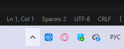
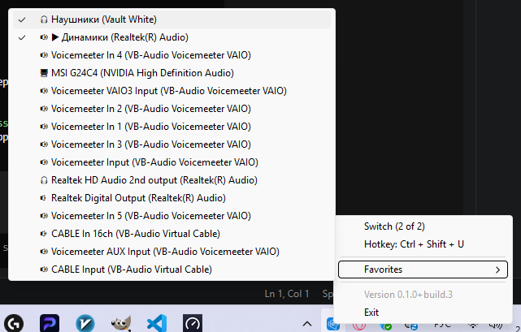
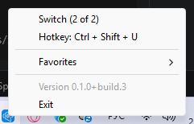

# Win Audio Switcher

A tiny Windows tray app that switches the default audio output device — one click, one global
hotkey, no window, no installers. Written in Rust on top of the Core Audio API.

## Screenshots

| Tray icon | Hover tooltip | Favorites (checkboxes + device types) |
|:--:|:--:|:--:|
|  |  |  |

Context menu:



<!-- Optional: add a screenshot or GIF of the tray menu here -->

## Features

- **Left-click the tray icon** — cycles through your favourite output devices (speakers → headphones → monitor → …).
- **Right-click** — context menu with every output device: favourites are marked, devices can be added
  with a single click, and the active device is highlighted. Includes “Exit”.
- **Global hotkey** — assign a combination (e.g. `Ctrl + Shift + U`) and switch devices from any
  application. Combinations without a modifier, or already taken by Windows/other apps, are rejected.
- **On-screen notification** — after each switch a small tooltip appears next to the tray icon for one
  second, showing the device name and its position in the cycle (`Device: 1 of 3`).
- **Favourites only** — the cycle never touches devices you did not mark. Unplugged favourites are
  skipped but remembered, and come back automatically when the device returns.
- **Single instance** — launching it twice never creates duplicate icons.
- **Portable** — a single `.exe`, no DLLs, no installer. Settings live in
  `%APPDATA%\SwitcherProgramm\config.json`.

## Requirements

- Windows 10 1809+ or Windows 11 (64-bit).
- No runtime dependencies: the Universal CRT ships with Windows.

## Build from source

```powershell
cargo build --release
```

The result is `target\release\SwitcherProgramm.exe` (~300 KB, statically linked apart from system DLLs).

Release profile is tuned for size: `opt-level = "z"`, `lto = "fat"`, `strip = true`, `panic = "abort"`.

## Usage

1. Run `SwitcherProgramm.exe` — the app goes straight to the tray.
2. Right-click the icon → **Favorites** → click a device to toggle its checkbox. Checked devices form
   the cycle; each entry is prefixed with a device-type symbol (🔊 speakers, 🎧 headphones,
   🖥 HDMI/DisplayPort, 🔈 digital, 🔉 line level).
3. Left-click the icon to cycle between the checked devices, or press your hotkey.
4. To assign a hotkey: right-click → **Hotkey: …** and press the combination.
   `Esc` cancels.

> The UI is localized: Russian for Russian Windows, English everywhere else.
> Override with the `SWITCHER_LANG=en|ru` environment variable.

## Configuration

`%APPDATA%\SwitcherProgramm\config.json`:

```json
{
  "devices": [
    "{0.0.0.00000000}.{...endpoint-id...}"
  ],
  "hotkey": {
    "modifiers": 6,
    "vk": 85
  }
}
```

- `devices` — stable endpoint IDs (not friendly names: names can change or repeat).
- `hotkey.modifiers` — Win32 bitmask (`Alt = 1`, `Ctrl = 2`, `Shift = 4`, `Win = 8`), `hotkey.vk` — virtual-key code.
- The file is written atomically (temp file + rename) and is safe to delete at any time.

## Diagnostics

The executable has headless modes that are handy when debugging audio issues:

```powershell
SwitcherProgramm.exe --list          # list render devices, mark the current default
SwitcherProgramm.exe --switch <N>    # make device N the system default
SwitcherProgramm.exe --toast-test    # verify the notification: visibility, position, auto-hide
SwitcherProgramm.exe --hotkey-test   # verify reserved-combo rejection and WM_HOTKEY delivery
SwitcherProgramm.exe --lang          # print the detected UI language and sample strings
SwitcherProgramm.exe --version       # print the version with the build number
```

## Versioning

The version is `Cargo.toml` version plus a build number: `0.1.0+build.42`. It is shown as a disabled
line above “Exit” in the tray menu.

- The build number lives in `build-number.txt` and is incremented by `build.rs` on release builds only;
  debug builds reuse the stored value.
- `SWITCHER_BUILD_NUMBER` overrides it (CI or a manual release) without touching the file.
- Commit the updated `build-number.txt` together with the release commit.

## How it works

- **Devices** are enumerated through the MMDevice API (`IMMDeviceEnumerator`), friendly names come
  from `PKEY_Device_FriendlyName`.
- **Switching** uses the undocumented `IPolicyConfig` COM interface (`CPolicyConfigClient`), the same
  approach as SoundSwitch and EarTrumpet. Windows has no public API for this. `SetDefaultEndpoint` is
  called for all three roles (`Console`, `Multimedia`, `Communications`) so that already-playing
  applications move over too.
- **Tray** is `tray-icon`; the notification is a native `tooltips_class32` tracking tooltip.
- **One icon for everything**: `assets/app-icon.png` (512×512) is the master; `build.rs` embeds a
  multi-size `.ico` into the executable and a 32×32 frame for the tray.
- **Hotkey** is `RegisterHotKey` with `hwnd = NULL`, so `WM_HOTKEY` arrives in the app's own message
  loop from any foreground application.

See [`docs/windows-apis.md`](docs/windows-apis.md) for the collected Win32/COM details and pitfalls,
and [`docs/architecture.md`](docs/architecture.md) for the module layout and event flow.
Russian versions live in [`docs/ru/`](docs/ru/).

## Notes

- `IPolicyConfig` is undocumented and not guaranteed by Microsoft; it works from Windows 7 through 11.
- The app never modifies anything except the default audio endpoint and its own config file.
- Autostart (planned) will use `HKCU\Software\Microsoft\Windows\CurrentVersion\Run`.

## License

MIT — see [LICENSE](LICENSE).
